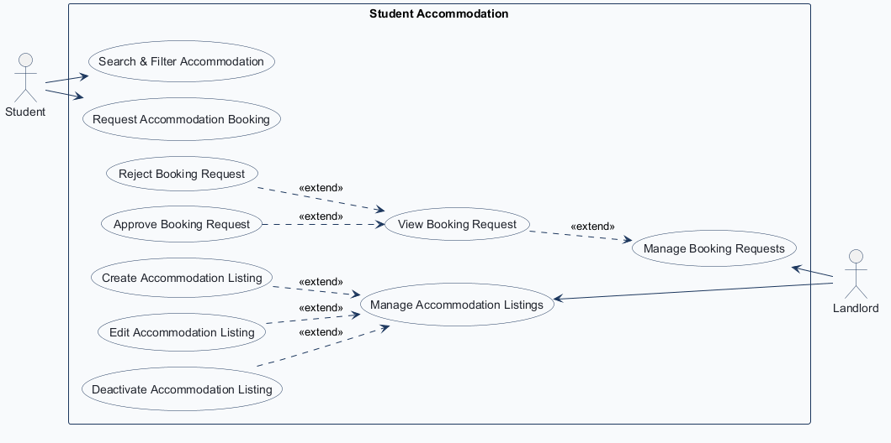
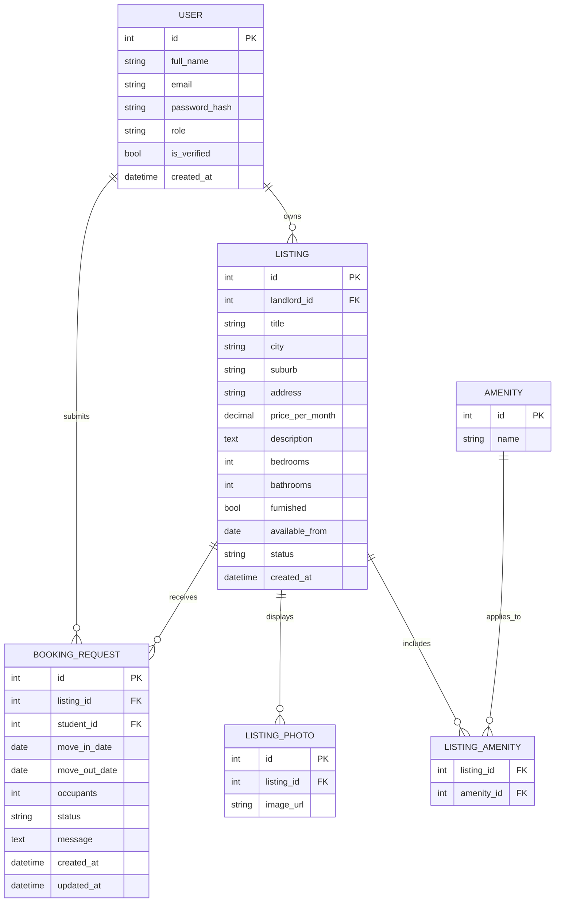
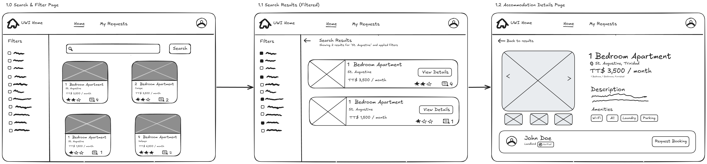
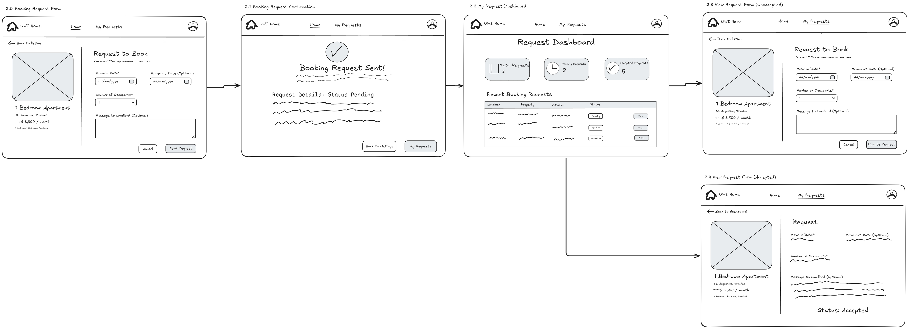
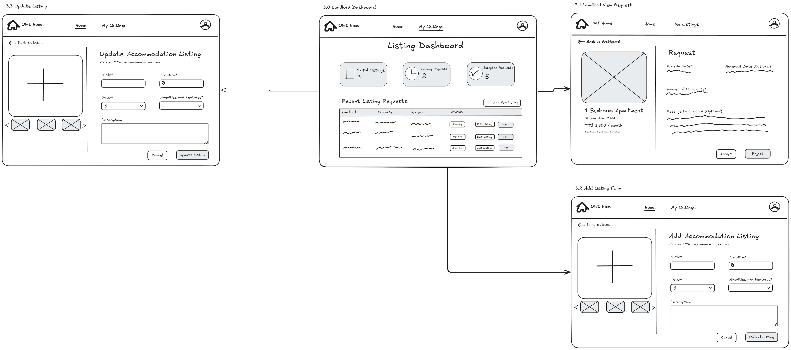
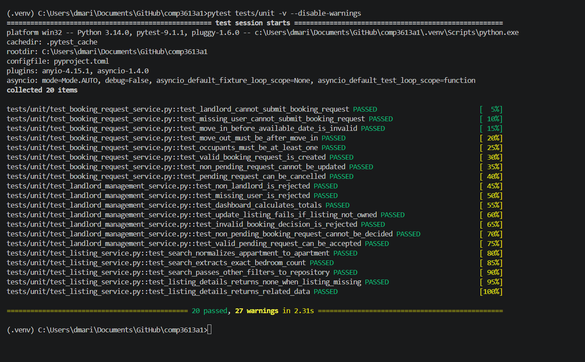
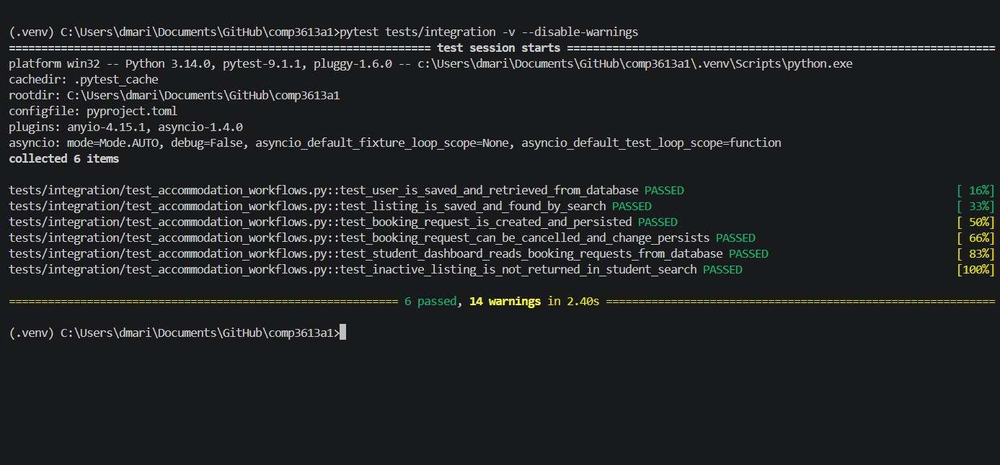
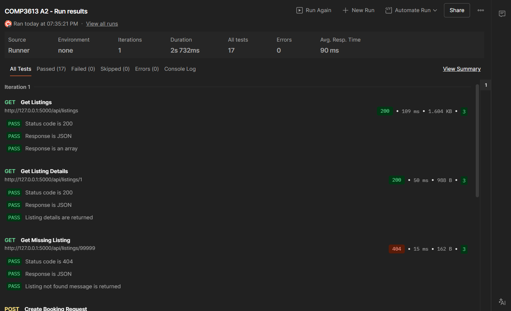

# COMP3613 Assignment 2 Report

## 1. Cover Page

**D'mari Williams**  
**ID:** 816043902  
**COMP3613 Assignment 2**  
**Student Accommodation Project**

---

## 2. Project Description

The project is an Airbnb-like student accommodation marketplace. Students can search and filter nearby accommodation and submit booking requests, while landlords can manage accommodation listings and booking requests. This report continues the Student Accommodation project documented in Assignment 1.

## 3. Use Case Diagram

The existing Assignment 1 use-case diagram shows the Student and Landlord actors and the project's search, booking, listing-management, and booking-request workflows.

## 4. Entity Relationship Diagram

The following ERD source is taken from the Assignment 1 report.

## 5. Application Wireframes

The following are the existing Assignment 1 wireframes.

### Search & Filter Accommodation — Student

### Request Accommodation Booking — Student

### Manage Listings & Booking Requests — Landlord

## 6. Test Planning

### User Acceptance Test Plan

The UAT workflows below are based on the Assignment 1 wireframes. All three planned workflows were manually executed and passed.

| Test Case | Pre-conditions | Test Steps | Test Criteria / Expected Result | Success |
|---|---|---|---|---|
| Search & Filter Accommodation — Student | Application is available; student is signed in; at least two listings with different locations or attributes are available. | Open accommodation search; enter a location and select filters; submit; review results and open listing details. | Results match the search and selected filters. Details show the accommodation, images, amenities, and landlord, with a way back to results. | Pass |
| Request Accommodation Booking — Student | Student is signed in; an available listing can be opened and supports a valid requested date. | Open listing details and choose Request Booking; enter move-in date, optional move-out date, occupant count, and optional message; send request; open My Requests. | Confirmation is shown. The student's dashboard shows the new Pending request and its details. Pending requests have update/cancel controls; accepted requests are read-only. | Pass |
| Manage Listings & Booking Requests — Landlord | Landlord is signed in; account has a listing and a request for one of its listings. | Open the landlord dashboard; review listing and request information; open a request and accept or reject it; return to the dashboard and open Add Listing or Edit Listing; submit listing information. | Dashboard shows listings and request statuses. A pending request can be accepted or rejected and its updated status is reflected. The landlord can submit a new listing or save listing changes. | Pass |

### Unit Test Plan

Unit tests test methods and functions in isolation. Their repository dependencies are mocked, and they have no database dependency.

| Unit Test | Module Tested | Expected Output |
|---|---|---|
| `test_search_normalizes_appartment_to_apartment` | `ListingService.search_listings` | Normalizes the misspelled search phrase and passes the normalized location and default filters to the repository. |
| `test_search_extracts_exact_bedroom_count` | `ListingService.search_listings` | Removes the exact-bedroom phrase from the location and passes the exact bedroom count to the repository. |
| `test_search_passes_other_filters_to_repository` | `ListingService.search_listings` | Forwards the normalized location and supplied price, bedroom, bathroom, furnishing, and availability filters. |
| `test_listing_details_returns_none_when_listing_missing` | `ListingService.listing_details` | Returns `None` when the repository cannot find an available listing. |
| `test_listing_details_returns_related_data` | `ListingService.listing_details` | Returns the listing, landlord, photos, and amenities, retrieving related records through the repository. |
| `test_landlord_cannot_submit_booking_request` | `BookingRequestService.require_booking_student` | Raises `PermissionError` for a landlord account. |
| `test_missing_user_cannot_submit_booking_request` | `BookingRequestService.require_booking_student` | Raises `PermissionError` when the user does not exist. |
| `test_move_in_before_available_date_is_invalid` | `BookingRequestService._validate_request` | Raises `ValueError` when the requested move-in date precedes the listing's available date. |
| `test_move_out_must_be_after_move_in` | `BookingRequestService._validate_request` | Raises `ValueError` when the move-out date is not after the move-in date. |
| `test_occupants_must_be_at_least_one` | `BookingRequestService._validate_request` | Raises `ValueError` when the occupant count is below one. |
| `test_valid_booking_request_is_created` | `BookingRequestService.create_booking_request` | Creates and returns a pending request with the supplied student, listing, occupant, and date data. |
| `test_non_pending_request_cannot_be_updated` | `BookingRequestService.update_booking_request` | Raises `ValueError` when attempting to update a non-pending request. |
| `test_pending_request_can_be_cancelled` | `BookingRequestService.cancel_booking_request` | Cancels a pending request through the repository and returns the request. |
| `test_non_landlord_is_rejected` | `LandlordManagementService.require_landlord` | Raises `PermissionError` for a non-landlord account. |
| `test_missing_user_is_rejected` | `LandlordManagementService.require_landlord` | Raises `PermissionError` when the account does not exist. |
| `test_dashboard_calculates_totals` | `LandlordManagementService.dashboard` | Returns total listings, pending requests, and accepted requests counts from repository data. |
| `test_update_listing_fails_if_listing_not_owned` | `LandlordManagementService.update_listing` | Raises `LookupError` when the landlord does not own the requested listing. |
| `test_invalid_booking_decision_is_rejected` | `LandlordManagementService.decide_booking_request` | Raises `ValueError` for an unsupported booking decision. |
| `test_non_pending_booking_request_cannot_be_decided` | `LandlordManagementService.decide_booking_request` | Raises `ValueError` when attempting to decide a request that is not pending. |
| `test_valid_pending_request_can_be_accepted` | `LandlordManagementService.decide_booking_request` | Accepts a valid pending request and asks the repository to persist the accepted status. |

### Integration Test Plan

Integration tests use a per-test, in-memory SQLite database. They use actual models, repositories, services, and database sessions to verify persistence and interactions between those components and the database.

| Test | Dependencies | Description |
|---|---|---|
| `test_user_is_saved_and_retrieved_from_database` | In-memory SQLite test database, `User`, `UserRepository` | Saves a user, commits and refreshes it, then retrieves it by ID and verifies username and email. |
| `test_listing_is_saved_and_found_by_search` | In-memory SQLite test database, `User`, `Listing`, `ListingRepository`, `ListingService` | Persists users and a listing, searches through the service/repository, and verifies the matching listing is returned. |
| `test_booking_request_is_created_and_persisted` | In-memory SQLite test database, user/listing/booking request models and repositories, `BookingRequestService` | Creates a booking request through the service and verifies the request and its student, listing, message, and pending status are persisted. |
| `test_booking_request_can_be_cancelled_and_change_persists` | In-memory SQLite test database, user/listing/booking request models and repositories, `BookingRequestService` | Creates and cancels a request through the service, then reloads it and verifies its status is `cancelled`. |
| `test_student_dashboard_reads_booking_requests_from_database` | In-memory SQLite test database, user/listing/booking request models and repositories, `BookingRequestService` | Creates two requests and verifies the student dashboard totals, statuses, and rows reflect database records. |
| `test_inactive_listing_is_not_returned_in_student_search` | In-memory SQLite test database, user/listing models, `ListingRepository`, `ListingService` | Persists an inactive listing and verifies student search does not return it. |

## 7. Test Implementation

### Repository Link

[BossDNW/comp3613-a1](https://github.com/BossDNW/comp3613-a1)

### Unit Tests

The existing unit test files contain 20 passing tests:

| Pytest file | Tests | Coverage summary |
|---|---:|---|
| `tests/unit/test_listing_service.py` | 5 | Listing search normalization and filter forwarding; listing details and related data. |
| `tests/unit/test_booking_request_service.py` | 8 | Student authorization, request validation, creation, update restrictions, and cancellation. |
| `tests/unit/test_landlord_management_service.py` | 7 | Landlord authorization, dashboard counts, listing ownership, and booking decision validation and acceptance. |

### Integration Tests

`tests/integration/test_accommodation_workflows.py` contains 6 passing tests covering user persistence, listing search, booking-request creation and cancellation, student dashboard reads, and exclusion of inactive listings from student search.

### API/Postman Tests

The following REST API routes are implemented and documented for Postman testing:

| Method and route | Tested outcome |
|---|---|
| `GET /api/listings` | 200 |
| `GET /api/listings/{listing_id}` | 200 |
| Missing listing | 404 |
| Unauthenticated booking request | 401 |
| Successful login | 303 |
| Authenticated booking request | 201 |
| Invalid booking request | 422 |
| `GET /api/requests` | 200 |

The Postman collection was completed and exported to `postman/COMP3613_A2.postman_collection.json`.

## 8. Test Reporting

| Test area | Result |
|---|---|
| Unit tests | 20 passed |
| Integration tests | 6 passed |
| Postman collection | 17 passed, 0 failed, 0 skipped, 0 errors |
| User acceptance testing | 3/3 planned workflows passed |

### Verification Results

The existing pytest suite was run with `python -m pytest -q tests\unit tests\integration`: **26 passed** (20 unit and 6 integration). The run emitted 41 deprecation warnings.

## 9. Evidence

The following existing screenshots are included as evidence.

### Unit Test Screenshot

### Integration Test Screenshot

### Postman Collection Run Screenshot

