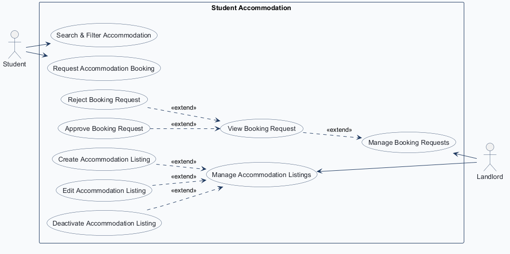
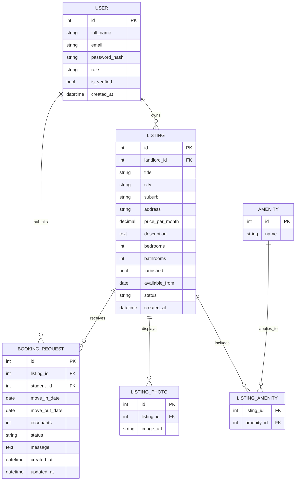
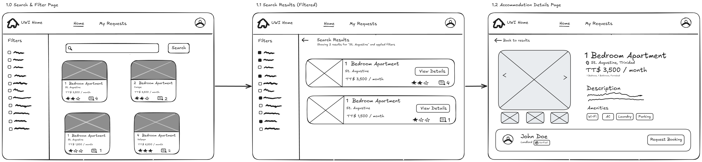
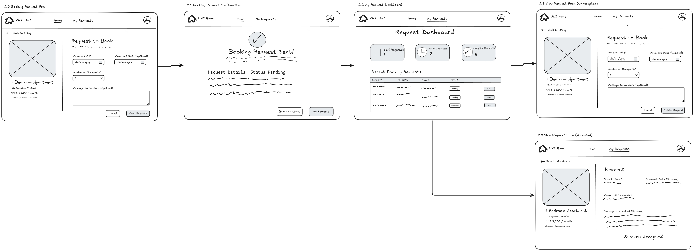
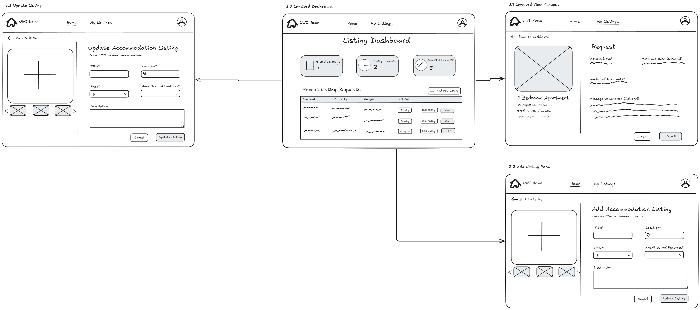

<!-- student-build:skill-integrity
status: pass
root: e84cd692d0b85eefe546385661958c27d07e8be6c5176a82012f68ccff5c8beb
expected_root: e84cd692d0b85eefe546385661958c27d07e8be6c5176a82012f68ccff5c8beb
mismatches: none
-->

# COMP 3613 Assignment 1

Draft this file with the Guide. **Update it after every phase milestone** before you pause. The use-case diagram is a UML PNG at `docs/diagrams/use-case.png`, linked from this file as `diagrams/use-case.png` (path relative to `docs/report.md`). The model diagram is Mermaid. **Embed wireframe images** as `wireframes/<file>` (files live in `docs/wireframes/`).

Do not put your student ID in this file if you will commit it. The PDF cover adds your name and ID at export time.

## Assigned project
Student Accommodation

## Interpretation

The project is an Airbnb-like student accommodation marketplace. Students can search and filter nearby accommodation and submit booking requests, while landlords can manage accommodation listings and booking requests. This interpretation reflects the Student Accommodation brief and the implemented project scope.

## Submission details

- GitHub repository: https://github.com/BossDNW/comp3613-a1
- Agents used: GitHub Copilot Agent (Phases 1-5); OpenCode (Phase 6)

## Three workflows

### 1. Search & Filter Accommodation (Student)

### 2. Request Accommodation Booking (Student)

### 3. Manage Listings & Booking Requests (Landlord)

## Use case diagram

Phase 2 notes: Student starts search/filter and booking requests. Landlord management covers listing creation, editing, and deactivation, plus viewing, approving, and rejecting booking requests. The former detail-view and review workflows are not included in the revised workflow list.

## Model diagram

First draft. Update this section in Phase 5 when polish revises the model, and note what changed.

Phase 3 notes: A `User` can act as either a student or a landlord through the `role` field, while `is_verified` helps support trust in the accommodation marketplace. One landlord can own many listings, and each listing contains the fields needed for search and filter, such as location, price, bedrooms, bathrooms, furnishing, and vacancy date. Each student can submit many booking requests, and a landlord can approve, reject, or cancel them through a single request record. Amenity data is modelled through a join table so a listing can include multiple features without repeating columns. The earlier review/detail extension was removed from the model because the revised workflow list focuses on listing management and booking decisions rather than reviewing or browsing detailed listing pages.

Phase 5 wireframe revision: Added `ListingPhoto` because the search cards and accommodation details wireframe display listing photos and a gallery. Ratings/review counts remain out of scope by student choice; no review entity or review widgets are included.

Phase 5 booking revision: Added `BookingRequest.occupants` for the required number-of-occupants form field. Student-selected behavior: pending requests can be updated or cancelled; accepted requests are read-only. Move-in dates earlier than the listing's `available_from` are rejected. The landlord's decision actions remain part of the landlord workflow.

## Wireframes

### Search & Filter Accommodation (Student)

### Request Accommodation Booking (Student)

### Manage Listings & Booking Requests (Landlord)

## Theming

Branding preferences and how they were applied (landing / login / register).

- Colors: modern student-housing palette using a bright blue primary, soft white surfaces, and teal accent highlights.
- Type: clean sans-serif UI with strong, readable headings for a trustworthy academic-housing feel.
- Tone: clear, useful, and welcoming; focused on helping students quickly find and book suitable accommodation.
- Wordmark: Student Accommodation.

Applied to the public landing page and the auth screens with a blue/white card layout, softened gradients, and a more direct student-rental message.

## Implementation notes

One named workflow at a time. Include verify notes and polish / model revisions (Phase 5). Do not treat the first build as final.

### Search & Filter Accommodation (Student) — wireframe alignment pass

- Student chose separate search, filtered-results, and listing-details pages.
- Search fields follow the corrected selection: city/suburb location, maximum monthly price, move-in date, bedrooms, bathrooms, and furnished status. Keyword and minimum-price fields were removed.
- Search/result cards show the image area, title, location, monthly price, and a View Details action. The details page shows the image gallery, location, price, description, amenities, landlord panel, and booking action. Ratings and review counts were deliberately left out.
- The results route passes normalized filters to `ListingService`; repository methods own listing/photo/amenity data access. The detail service coordinates listing lookup and related data; missing listings return 404.
- Search polish: demo listings are restricted to Trinidad and locations around the UWI St. Augustine campus / other Trinidad communities. The location field now searches listing titles and location/details text token-by-token. Common misspelling `appartment` is normalized to `apartment`; phrases such as `1 bedroom apartment` also match the exact bedroom count stated in the phrase. The separate bedroom filter remains a minimum.
- Model revision: `ListingPhoto` belongs to one `Listing` through `listing_id`; the existing `Amenity` / `ListingAmenity` ERD structure is registered and read for the detail page.
- Styling polish: strengthened the marketplace navigation bar, made it sticky on desktop, increased contrast and separation between filter and results panels, and added clearer card borders/shadows. The shared stylesheet URL now has a version query so browsers request the updated CSS.
- Verification: student confirmed all three named workflows are working, including searching listings by listing title and Trinidad location.

### Request Accommodation Booking (Student)

- Implemented a listing-specific request form with required move-in date and occupant count plus optional move-out date and message.
- Successful submission creates a pending request, shows a confirmation page, and links to the student's request dashboard.
- The dashboard shows total, pending, and accepted counts plus the student's recent requests. Students can view their own request only; pending requests can be edited or cancelled, and non-pending requests are read-only.
- Service rules reject unavailable listings, move-in dates before the listing availability date, move-out dates that are not after move-in, and occupant counts below one.
- Persistence is in `BookingRequestRepository`; routes delegate to `BookingRequestService`. Request lookups are scoped to the authenticated student's ID.
- Runtime issue follow-up: removed duplicate service/repository method definitions that shadowed the validated create flow. Database recovery now retries a failed-schema request once and propagates a second failure instead of redirecting the same GET URL indefinitely. The local SQLite `bookingrequest` table was confirmed to contain only `id`; after the student's approval to reset local data, `python manage.py init` recreated the schema and demo data. The table now contains the full request schema (`listing_id`, `student_id`, dates, occupants, status, message, timestamps).
- Verification: Pylance and Python syntax checks pass; schema inspection confirms the booking request columns now exist. Student confirmed the booking workflow works.

<!-- student-build:code-check
workflow: Request Accommodation Booking (Student)
form: choice
layer: service
architecture_ok: yes
implement_confidence: 0.90
passed: yes
note: Chose pending requests editable/cancellable and accepted requests read-only; identified service as coordinating request validity.
-->

<!-- student-build:code-check
workflow: snippet
layer: model
architecture_ok: yes
implement_confidence: 0.90
passed: yes
note: Student added BookingRequest ERD fields plus the occupant count from the wireframe.
-->

<!-- student-build:code-check
workflow: snippet
layer: router
architecture_ok: yes
implement_confidence: 0.90
passed: yes
note: Student implemented POST handler calling BookingRequestService; no persistence logic in the route.
-->

### Manage Listings & Booking Requests (Landlord)

- Landlord wireframe implemented from `wireframes/manage-listings-booking-requests.png`: dashboard totals, recent booking requests, listing rows, request detail with accept/reject, and add/edit/deactivate/reactivate listing paths.
- Listing creation and editing use the existing `Listing`, `ListingPhoto`, `Amenity`, and `ListingAmenity` ERD entities. The student selected direct image URL fields; photo URLs are validated and saved as `ListingPhoto.image_url`.
- Listing/request persistence is in `LandlordManagementRepository`; `LandlordManagementService` enforces landlord role, listing ownership, request ownership, validation, and pending-only accept/reject actions. Landlord routes call the service and contain no persistence queries.
- Landlord listings are restricted to Trinidad locations; their entered location is stored in the existing listing location fields. Deactivated listings are marked inactive and are excluded by student search.
- The seed command now adds a small set of amenities idempotently; run `python manage.py seed` to make the feature choices available without resetting existing data.
- Polish from student testing: landlord accounts cannot submit booking requests. The student-side action is hidden for landlords, and GET/POST request entry points enforce the role restriction.
- Verification: Pylance, syntax, and diff whitespace checks pass. Student confirmed the landlord dashboard, listing, and request flows work against the wireframe, and retested that landlords cannot see or directly access booking-request submission.

<!-- student-build:code-check
workflow: Manage Listings & Booking Requests (Landlord)
form: snippet
layer: router
architecture_ok: yes
implement_confidence: 0.83
passed: yes
note: Student implemented a thin landlord dashboard route that calls LandlordManagementService and renders the dashboard.
-->

<!-- student-build:code-check
workflow: Manage Listings & Booking Requests (Landlord)
form: choice
layer: other
architecture_ok: yes
implement_confidence: 0.83
passed: yes
note: Selected image URL fields for listing photos.
-->

<!-- student-build:code-check
workflow: Manage Listings & Booking Requests (Landlord)
form: snippet
layer: model
architecture_ok: yes
implement_confidence: 0.83
passed: yes
note: Added ListingPhoto.image_url to match the selected image URL input.
-->

### Account Profile

- The top-right person icon opens Profile Settings; the page supports a separate full/display name while keeping the username as the sign-in identifier.
- Password changes require the current password, a matching confirmation, and a minimum eight-character new password.
- Account deletion requires the current password, a checkbox confirmation, and a browser confirmation prompt. As selected by the student, deletion permanently removes the user's listings and the booking requests associated with the student or those listings.

- Profile updates and deletion are coordinated through `ProfileService` and persisted through `UserRepository`; routes do not contain SQL.
- Added an idempotent schema migration for the new `user.full_name` column so existing databases can retain their data.
- Applied the additive migration to the current local database and confirmed the `full_name` column exists.

<!-- student-build:code-check
workflow: Account Profile
form: choice
layer: service
architecture_ok: yes
implement_confidence: 0.90
passed: yes
note: Chose separate display name, current-password verification for password changes and deletion, and deleting associated listings/requests.
-->

<!-- student-build:code-check
workflow: snippet
layer: model
architecture_ok: yes
implement_confidence: 0.90
passed: yes
note: Student added the separate full_name field to the User model.
-->

<!-- student-build:code-check
workflow: snippet
layer: router
architecture_ok: yes
implement_confidence: 0.90
passed: yes
note: Student completed the profile GET route to call ProfileService and render the profile template.
-->

<!-- student-build:code-check
workflow: Search & Filter Accommodation (Student)
form: choice
layer: other
architecture_ok: yes
implement_confidence: 0.85
passed: yes
note: Chose separate search, results, and details pages; chose ListingPhoto for multiple photos per listing; chose to omit reviews/ratings.
-->

<!-- student-build:code-check
workflow: Search & Filter Accommodation (Student)
form: mcq
layer: service
architecture_ok: yes
implement_confidence: 0.90
passed: yes
note: Identified the service as coordinating listing lookup and missing-listing behavior.
-->

<!-- student-build:code-check
workflow: Search & Filter Accommodation (Student)
form: open
layer: service
architecture_ok: yes
implement_confidence: 0.90
passed: yes
note: Explained that the route passes selected filters, the service coordinates filtering, and the repository handles database access.
-->

<!-- student-build:code-check
workflow: Search & Filter Accommodation (Student)
form: snippet
layer: model
architecture_ok: yes
implement_confidence: 0.90
passed: yes
note: Student added ListingPhoto with a listing foreign key and image_url.
-->

<!-- student-build:code-check
workflow: Search & Filter Accommodation (Student)
form: snippet
layer: router
architecture_ok: yes
implement_confidence: 0.90
passed: yes
note: Student implemented filtered results by calling ListingService.search_listings; no persistence logic in the route.
-->

### Phase 5 polish and exit

- Student confirmed that Search & Filter Accommodation, Request Accommodation Booking, and Manage Listings & Booking Requests all work.
- Incorporated the reported landlord-role restriction: landlord accounts can manage requests but cannot submit booking requests.
- Updated the landing-page demo login text to show the landlord demo credentials.
- Phase 5 exit gate met; local workflow verification and student-directed polish are recorded above. Phase 6 deployment completed on Render with a Render Postgres database and public web service.

## Deployed app

Phase 6. Public Render URL (not localhost). Markers open this to mark the three workflows.

https://faststarter-b9hn.onrender.com

## Logins

Every account a marker needs, including extra users you added. Starter accounts:

- bob / bobpass — regular user
- landlord / landlordpass — landlord

These accounts are created by `python manage.py init` on the deployed Render Postgres database.

## YouTube URL

https://youtu.be/Ko-H9i3UrSY

## Session transcripts

Filled when the Guide builds the report: the agent writes chat markdown into `docs/transcripts/`; `python manage.py report` packages them.

Guide packaged **7** chat(s) in `docs/transcripts/` (and `docs/transcripts.zip`).

Index: [docs/transcripts/INDEX.md](transcripts/INDEX.md)

- [`phase-4-wireframes-copilot-agent`](transcripts/phase-4-wireframes-copilot-agent.md)
- [`phase-5-build-polish-copilot-agent`](transcripts/phase-5-build-polish-copilot-agent.md)
- [`phase-6-copilot-deploy-attempt-initial`](transcripts/phase-6-copilot-deploy-attempt-initial.md)
- [`phase-6-copilot-deploy-attempt-reconnect-1`](transcripts/phase-6-copilot-deploy-attempt-reconnect-1.md)
- [`phase-6-copilot-deploy-attempt-reconnect-2`](transcripts/phase-6-copilot-deploy-attempt-reconnect-2.md)
- [`phase-6-copilot-deploy-attempt-worktree-check`](transcripts/phase-6-copilot-deploy-attempt-worktree-check.md)
- [`phase-6-deploy`](transcripts/phase-6-deploy.md)

## Competency (student-judge)

Filled by Guide from the student-judge run when this report was built.

**Judged at:** 2026-10-14T01:03:54-04:00
**Evidence pass:** re-read the current project report, use-case and wireframe artifacts, available native Copilot Agent text messages from Phases 4 and 5 and four Phase 6 deployment attempts, and the OpenCode Phase 6 completion transcript; prior judge scorecards ignored.

**Student / session:** COMP 3613 Assignment 1 — Student Accommodation
**Artifact:** Current project artifacts and report; Copilot Agent Phase 4/5 transcripts and four Phase 6 deployment-attempt transcripts; OpenCode Phase 6 completion transcript
**Phases in evidence:** 1–6 (COMP 3613; Phase 5 polish, Phase 6 deploy)

### Totals
| | Count / value |
|--|--|
| Metrics on rubric | 12 (M1–M12) |
| N/A (excluded) | 0 |
| Metrics scored | 12 |
| Scoreable max | 48 |
| Awarded total | 42 / 48 |
| **Overall (avg of scored)** | **3.5 / 4** |
| Impression mark | 18 / 20 |

## Scorecard

| ID | Metric | Score / 4 | In avg | Evidence |
|----|--------|----------:|:------:|----------|
| M1 | Phase discipline | 3 | yes | The available Phase 4 chat precedes Phase 5, and the report documents design gates and polish before Phase 6 deployment. The student opened Phase 5 with “start phase 5.” Raw phase 1–3 Guide chats were not available for direct review. |
| M2 | Problem framing | 3 | yes | The report preserves the named project and three workflows; Phase 5 shows the student refining scope in their own words: “location, maximum price, move-in date etc”. Earlier Phase 1–3 decision turns are unavailable, so this score relies partly on the report record. |
| M3 | Decision ownership | 4 | yes | The student corrected the filter misunderstanding (“that wasnt the question it was about if it should have an extensive set of features to filter by, or max price, move in date etc”), flagged the wireframe mismatch, and steered Trinidad-only search and account behavior. |
| M4 | Artefact-before-code | 4 | yes | The Phase 4 chat records the student starting Phase 4 after adding wireframes; the report embeds the three wireframes. Phase 5 then responds to the mismatch report: “this does not follow my wireframes for the home page/search page at all.” |
| M5 | Verification habit | 4 | yes | The student reported a broken local URL and later a booking/dashboard failure, supplied the follow-up error attachments, and eventually confirmed “all 3 of my workflows are working now, complete phase 5.” The report records workflow-specific verification. |
| M6 | Assignment fit | 4 | yes | Layered architecture and code-check records align with the assignment. The Guide confirmed the search-results route “delegates filtering to `ListingService` without putting queries in the router,” and the report records architecture-compliant route snippets. |
| M7 | Slice explanation | 3 | yes | The student made concrete corrections and selected workflow behavior; the report also records model and thin-route code-checks. The text transcript does not preserve tool-level snippet edits, so direct authored-code evidence is limited to the project record. |
| M8 | Prompt quality | 3 | yes | The student used clear mismatch and workflow prompts, including “now work on the rquest accodation booking page and wireframe implementation” and concrete bug reports. Phase 6 prompts clearly name the deploy phase. Raw Phase 1–3 prompts are unavailable. |
| M9 | Response to pushback | 4 | yes | The student continued steering after each pass: they rejected the initial search page, identified CSS/nav problems, reported booking failures, requested Trinidad-specific search behavior, and only ended Phase 5 after confirming all three workflows worked. |
| M10 | Integrity | 4 | yes | No answer-seeking, paste-back, or laundering indicators appear in the available chat turns. The checkpoint summary was excluded as a transcript, and the protected skill-integrity verification passed. |
| M11 | Provenance continuity | 3 | yes | The available chats and artifacts align with the same Student Accommodation workflows, wireframes, and model. The direct Phase 1–3 chat transcripts were not available, limiting full cross-phase turn provenance. |
| M12 | Sincerity trajectory | 3 | yes | No sincerity-protocol blocks or laundering indicators appear in the available Phase 4/5 and Phase 6 evidence. Earlier Copilot phase chats are unavailable, so the full trajectory cannot be directly assessed. |

## Strengths
- The student actively compared the build against the supplied wireframes and requested specific corrections instead of accepting the first implementation.
- User-owned scope and behavior choices are visible in the Phase 5 chat, including filters, booking behavior, Trinidad listing search, and landlord restrictions.
- Verification and follow-up troubleshooting are documented across the three workflows.
- The code-check record and implementation follow the intended layered architecture.
- Phase 4/5 Copilot messages, the available blocked Phase 6 Copilot attempts, and the Phase 6 OpenCode completion transcript are packaged from source records without reconstructing missing dialogue.

## Gaps (priority order)
1. The raw Copilot Agent chats for Phases 1–3 are not available in the local chat history. The report contains the relevant design artifacts and notes, but these are not substitutes for missing verbatim chat transcripts. Two pasted-text attachment payloads referenced during Phase 5 were also unavailable; their original references remain in the transcript.

## Phase gate status
| Phase | Status | Note |
|-------|--------|------|
| 1 | met | Project and three workflows are documented; native chat transcript unavailable. |
| 2 | met | Use-case diagram and include/extend notes are present; native chat transcript unavailable. |
| 3 | met | ERD, entity/property decisions, and relationship notes are present; native chat transcript unavailable. |
| 4 | met | Three wireframes are embedded, and the available Copilot Phase 4 chat is included. |
| 5 | met | Theme/build/polish, workflow verification, and a Copilot transcript are recorded. |
| 6 | met | Copilot deployment attempts were blocked by missing Render tools; the final Render deployment, public URL, marker logins, and successful OpenCode transcript are present. |

## Recommended next practice
- Preserve or export the original Copilot Phase 1–3 chats and pasted-text attachment payloads if they are available in the Copilot history; do not recreate them from report notes.

## Integrity note
- Clean; no fabrication found. Phase 1–3 Copilot chat records and two pasted-text attachment payloads were not available.

## Provenance flags
- None. Availability limitation noted above.

## Sincerity log summary
- Blocks found: 0 in available evidence | max round: N/A | min/mean/final confidence: N/A | trend: N/A | cleared: N/A; Phase 1–3 chats unavailable.

## Skips
- Skips: 0/3 used (from available Guide records). Skips are not an integrity failure.

## Skill integrity

Course skills are hashed at export and compared to `.agents/skills.lock.json`. Do not edit `.agents/skills/`, `.cursor/skills/`, or `AGENTS.md`.

- Status: **pass**
- Root: `e84cd692d0b85eefe546385661958c27d07e8be6c5176a82012f68ccff5c8beb`
- none
